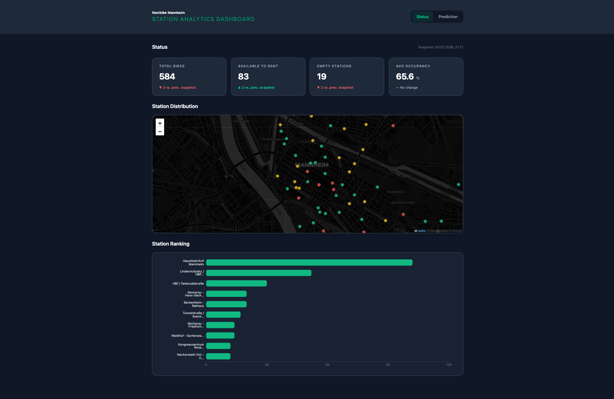
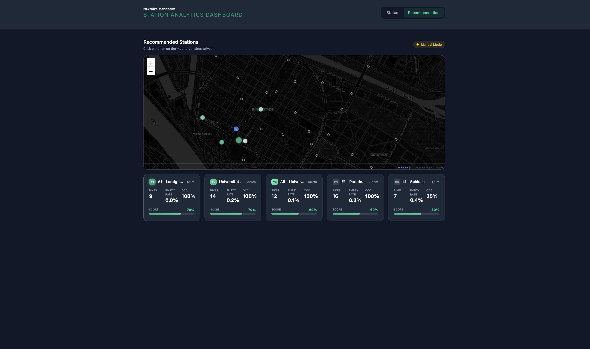

# Spatial-Temporal Demand Modeling for Bike Sharing Systems

This project focuses on modeling and visualizing the spatial-temporal demand for bike-sharing systems, specifically focused on the NextBike network in Mannheim. It combines an automated data pipeline, a REST API backend, and an interactive React dashboard to explore station status, occupancy, and distribution in real time.

## Features

- **Automated Data Pipeline**: A continuous background job that fetches live snapshot data every 30 minutes from the Mannheim Open Data portal and persists it to a PostgreSQL database.
- **REST API**: A FastAPI backend that serves KPI metrics, station data, and station recommendations to the frontend via endpoints.
- **Interactive Dashboard**: A React + TypeScript SPA with page-based routing (Status, Recommendation)
- **Geospatial Visualization**: Interactive Leaflet maps to visualize station locations, bike availability, and occupancy rates.
- **KPI Monitoring**: Real-time tracking of total bikes, available-to-rent count, empty stations, and average occupancy — with snapshot-over-snapshot deltas.
- **Station Ranking**: A horizontal bar chart ranking stations by bike count with color-coded availability indicators.
- **Station Recommendations**: GPS-based endpoint that scores nearby stations by combining bike availability, historical reliability, walking distance, and recent demand trend.

### Screenshots


*Dashboard Status Page*


*Recommendation Page with selected Station and recommended Stations*

## Data Source

The pipeline fetches live bike-sharing data from the **City of Mannheim Open Data Portal** via the [Opendatasoft](https://www.opendatasoft.com/) API:

- **Dataset**: `free_bike_status` — real-time status of all NextBike stations in Mannheim
- **Endpoint**: `https://mannheim.opendatasoft.com/api/explore/v2.1/catalog/datasets/free_bike_status/exports/json`
- **Format**: JSON export containing station name, coordinates, number of bikes, free racks, and total rack capacity
- **Update Frequency**: The pipeline polls this endpoint every **30 minutes** and stores a timestamped snapshot in the PostgreSQL database

The portal is publicly accessible and does not require authentication.

## Installation

1. **Clone the repository**:
   ```bash
   git clone https://github.com/janicksturm/bike-sharing-analytics-mannheim.git
   cd bike-sharing-analytics-mannheim
   ```

2. **Install `uv`** (if not already installed):
   ```bash
   pip install uv
   ```

3. **Create a virtual environment and install dependencies**:
   ```bash
   uv sync
   ```

4. **Install frontend dependencies**:
   ```bash
   cd dashboard
   npm install
   ```

## Usage

### 4. Docker

The recommended way to run the full stack is with **Docker Compose**. This spins up four isolated containers (postgres, pipeline, API, dashboard).

1. **Start all services**:
   ```bash
   docker compose up -d --build
   ```

2. **Access the application**:
   - **Dashboard**: `http://localhost:3000`
   - **API**: `http://localhost:8000`
   - *(The pipeline and PostgreSQL database run automatically in the background)*

3. **Stop the services**:
   ```bash
   docker compose down
   ```